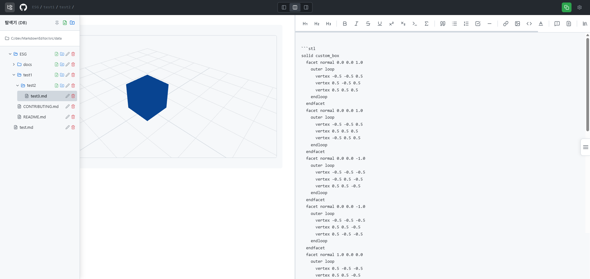

# Galmuri (갈무리)

GitHub 스타일 마크다운 편집기입니다. 왼쪽에서 쓰면 오른쪽에서 GitHub 와 같은 모양으로 바로 보입니다.

## 주요 기능

- 파일 탐색기와 마크다운 편집·실시간 미리보기 (GFM, 수식, 코드 구문 강조)
- 표, 다이어그램(Mermaid·순서도·파이 차트), GeoJSON·STL 미리보기
- SQL 쿼리 빌더(DDL·DML·DCL), SQL 예약어 자동완성, ERD 보기
- 템플릿, 찾기·바꾸기, 이미지 붙여넣기, 자동 저장

## 실행

```bash
npm install
npm run dev:all
```

또는 [GalmuriStart.bat](./GalmuriStart.bat) 을 실행합니다. 자세한 순서는 [시작 가이드](./docs/getting-started.md) 를 봅니다.

## 브랜치

- `main`: 작업용. 로컬 폴더를 읽고 쓰는 기능까지 모두 포함합니다.
- `deploy`: 배포용(Vercel). 서버 파일 시스템에 의존하는 기능을 뺐습니다.

## 문서

- [시작 가이드](./docs/getting-started.md)
- [파일 구조](./docs/filetree.md)
- [업데이트 내역](./CHANGELOG.md)

## 라이선스

MIT. [LICENSE](./LICENSE), [NOTICE.md](./NOTICE.md) 를 봅니다.
